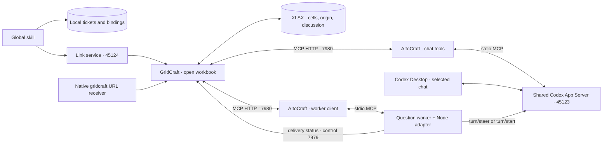

# Codex Desktop + GridCraft — experimental macOS example

Open a local XLSX from a link issued by a Codex Desktop chat. Questions in that workbook return
to that actual chat; answers and proposals travel through AItoCraft MCP. The reader applies or
rejects changes in GridCraft. A global skill makes this available from other local projects.

This example is version-sensitive. It uses the installed Desktop's `CODEX_APP_SERVER_WS_URL`
transport override, observed in Desktop 26.1007.30912 with bundled CLI 0.162.0-alpha.17.2. This
override is not presented as a stable public Desktop configuration contract. The public
[App Server protocol](https://learn.chatgpt.com/docs/app-server) and
[chat deep links](https://learn.chatgpt.com/docs/app/commands) are the message/navigation layers.
An ordinary Desktop launch uses an internal stdio server the external bridge cannot share.

The companion GridCraft changes target **agent-layer** and are described in
[its Codex contract](https://github.com/alexey-belkin/gridcraft/blob/codex/desktop-chat-routing/docs/codex-desktop.md).
No AItoCraft Rust hub behavior or default Claude installation is changed by this example.

## Install on a new Mac

Requirements: macOS, a signed-in ChatGPT/Codex Desktop app, Xcode Command Line Tools (including
Swift), Rust stable, Python 3.9+ at `/usr/bin/python3`, and Node 22+ with the built-in `WebSocket`.
The installer first tries Desktop's bundled Node; `--node` overrides it. Tested on macOS 26.2
arm64, Rust 1.99.1, Python 3.9 and bundled Node 24.21.0. No physical second Mac was claimed tested.

Install the tools from their official sources: [Desktop](https://learn.chatgpt.com/docs/app),
[Rust](https://rust-lang.org/tools/install/). On a clean Mac, run `xcode-select --install` if the
developer tools are missing, then install Rust using the official instructions and sign in to
Desktop normally. This example reuses that account; it does not request an API key.

The branches below are the review branches for the two companion contributions. After merge,
use `anton-belkin/gridcraft` at `agent-layer` and `anton-belkin/aitocraft` at `main` instead.

```sh
mkdir -p "$HOME/Code/aitocraft-codex"
cd "$HOME/Code/aitocraft-codex"
git clone --branch codex/desktop-chat-routing https://github.com/alexey-belkin/gridcraft.git
git clone --branch codex/desktop-chat-links https://github.com/alexey-belkin/aitocraft.git

cd gridcraft
cargo build --locked --release -p gridcraft -p gridcraft-cli
cd ../aitocraft
cargo build --locked --release

/usr/bin/python3 examples/codex-desktop/setup.py \
  --gridcraft ../gridcraft/target/release/gridcraft --install-skill
```

`setup.py` checks executable paths and Node capabilities, writes `installation.json`, builds and
registers a small native `gridcraft://` URL receiver, and generates two `.command` launchers.
`--install-skill` explicitly installs `gridcraft-chat-experimental` under `$CODEX_HOME/skills`
(default `~/.codex/skills`). Replacing an existing experimental skill needs `--replace-skill`;
the previous copy is backed up outside the discoverable skills directory.

Options: `--aitocraft`, `--desktop-app`, `--node`, `--state-dir`, `--skill-dir`, and `--no-register-links`.
When using a custom state directory outside the generated launchers, also export
`GRIDCRAFT_CODEX_STATE_DIR` to that directory. Installation paths are data, not hardcoded source.
Moving the checkouts requires rerunning setup to update the generated paths and skill entry.

## Start now and after every reboot

1. If Desktop is running normally, quit it yourself with **Cmd+Q**. Open
   `~/Library/Application Support/AItoCraft/Codex Desktop/Start Codex Desktop.command` in Finder.
   Keep that Terminal window open. It starts the shared server, then Desktop attached to it.
   On a first installation it opens Desktop normally; select/create the chat you want there.
2. Open `Start GridCraft.command` in the same directory. Keep its Terminal window open: it runs
   the question worker. It starts/reuses GridCraft and starts the detached local link service.
3. Open the intended chat in Desktop so it is loaded. The skill can now issue a link to any saved
   local XLSX. In Agent, check the actual chat name and the connection indicator.

There are **no login items, launchd services or automatic startup changes**. After reboot, repeat
steps 1–2; do not reinstall Rust, rebuild binaries, reinstall the skill or re-register the scheme
unless paths/binaries changed. The registry and PID files are transient; books, provenance,
bindings, tickets and the delivery journal stay on disk. There must be only one installation
using these fixed loopback ports at a time.

To explicitly open a particular existing chat, run:

```sh
/usr/bin/python3 examples/codex-desktop/shared_codex_desktop.py --launch --thread <technical-chat-uuid>
```

Without `--launch`, this prints a read-only launch plan. The launcher refuses to terminate an
already running Desktop or take over an occupied App Server port. Closing Desktop stops the
owned server; the GridCraft worker shows disconnection and waits for a valid shared launch.

## Make and use a link

In the chat that should receive the workbook's questions, ask:

> Use $gridcraft-chat-experimental: give me a GridCraft link to `/absolute/path/report.xlsx`
> and keep the work in this chat.

Or run from that chat's local shell:

```sh
/usr/bin/python3 ~/.codex/skills/gridcraft-chat-experimental/scripts/gridcraft_chat.py \
  issue "/absolute/path/report.xlsx"
```

The helper takes **the caller's `CODEX_THREAD_ID`**, never the launcher's last selected chat. It
returns a JSON `url` to use as `[Open in GridCraft](http://127.0.0.1:45124/open/<ticket>)`, plus
`deepLink`, `threadId`, and `targetAvailable`. If `targetAvailable=false`, opening the file is
still possible but delivery to that chat is not confirmed.

Click the HTTP link, then **Open file and connect this chat** on its page. The tested Desktop
rejects arbitrary `gridcraft://` links in chat messages, so the HTTP page is the clickable entry.
External applications can use the returned `gridcraft://open/<ticket>` directly. Both entry
points use the same opener. GET/link previews never open a file; opening is an explicit POST.

A ticket contains no path or account secret in the URL. Its local file stores the exact workbook
path and chosen chat, with a 30-day expiry. This is a same-Mac capability, not a web publication.
Copying the link to another computer does not transfer the book or chat. Keep the file at its
path or issue another link after moving it. Save As/reopen preserves the working binding.

The selected working chat has priority over saved origin, while leaving origin untouched.
For an explicitly requested creator chat, use `issue <path> --chat origin`. A book created by
another tool needs no origin tag to be linked to the issuing chat. Never stamp someone else's
file as created here. New books created by the chat can use `create_codex_workbook.py <new.xlsx>
--title <chat-title>` to save their real origin before populating them through the app.

If the requested chat is unavailable, the first question starts a new real Desktop chat on the
same server and the panel shows **Other chat**. It does not import history into a CLI process.
When the requested chat becomes available again it regains priority. The bridge preserves
delivery identity across save/reopen/restart so old questions are not reposted.

## Processes and architecture



| Component | Must remain active | Started by |
| --- | --- | --- |
| Shared App Server + Desktop | Throughout live chat work | First launcher |
| GridCraft with the workbook open | To read cells, ask, review and save | Second launcher or a link |
| Python worker + Node JSONL/WebSocket adapter | To forward new questions to the chosen chat | Second launcher; Connect Codex can restore it |
| AItoCraft instances | Managed stdio children for worker and chat tools | Worker and App Server |
| HTTP link service, 45124 | To open HTTP links; ongoing answers do not depend on it | Second launcher or `issue` |
| Native URL receiver | On demand for `gridcraft://`; not needed for ongoing answers | macOS LaunchServices |
| Global skill files | No background process | Installed by setup |

The two AItoCraft instances are the same hub binary with separate clients. The worker's Node
process is a transport adapter, **not another model agent**. While idle, the worker polls the
document and server metadata without keeping an LLM turn waiting. An active chat receives
`turn/steer`; an idle chat receives `turn/start`. No `codex exec/resume` is used.

All services bind to `127.0.0.1`: App Server 45123, link service 45124, GridCraft MCP 7980 and
control 7979. Do not expose them to the network. Other local processes can reach these local
interfaces; this is not a security boundary against an untrusted process running as the user.

## State, recovery and limits

Default state is `~/Library/Application Support/AItoCraft/Codex Desktop/`:

| Data | Purpose |
| --- | --- |
| `installation.json`, `apps/`, launchers | Installed binary/helper paths and URL receiver |
| `registry/`, `*.pid`, `*.lock`, `codex-desktop-runtime.json` | Current app discovery and process/endpoint bookkeeping |
| `run/gridcraft-links/tickets/`, `bindings.json` | Expiring links and chosen working chats |
| `run/desktop-deliveries.json` | Stable question/message identities and fallback routes |
| `logs/` | Startup, bridge, transport and link diagnostics |

If only the worker stops, restart the second launcher or use **Connect Codex**. If only the link
service stops, rerun `issue` or `gridcraft_links.py serve`; previously issued tickets still work.
If the shared server stops, restart Desktop with the first launcher. A normal Desktop launch
does not restore shared access. A connection loss after a message reservation may be ambiguous:
the journal marks it uncertain and the panel asks for attention instead of silently reposting.
Inspect the chat before asking the question again.

The example does not auto-approve App Server permission requests or modify global Claude/Codex
configuration. Approvals stay in Desktop. Browser/Computer Use availability is separate: the
live pass after a shared launch reported `native pipe closed before response`. Supported native
app commands were tested, but that pass did not claim fresh browser or Apply/Reject button clicks.
See [validation](VALIDATION.md) for the exact coverage and manual acceptance sequence.

## Tests

```sh
cd examples/codex-desktop
/usr/bin/python3 -m unittest -q test_desktop_bridge test_gridcraft_links test_setup
```

The tests use temporary state and fake request clients. They do not start Desktop, create a real
chat, register a URL handler or alter a real global skill. The Swift receiver can be compiled
separately with `xcrun swiftc GridCraftLink.swift -o /tmp/GridCraftLink`.
